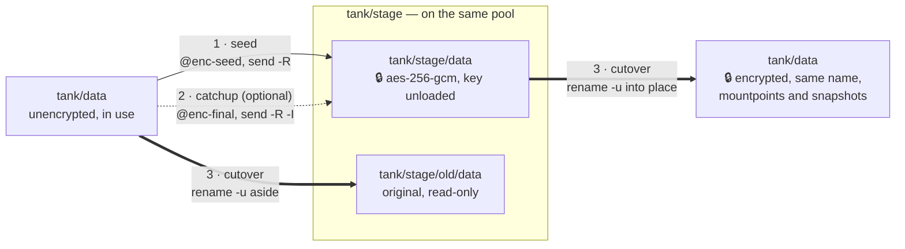

# ZFS Encrypt Migrate

[](https://pypi.org/project/zfs-encrypt-migrate/)
[](https://pypi.org/project/zfs-encrypt-migrate/)
[](https://zfs-encrypt-migrate.nijho.lt)
[](#nixos-module)
[](https://github.com/basnijholt/zfs-encrypt-migrate/actions/workflows/pytest.yml)
[](https://github.com/basnijholt/zfs-encrypt-migrate/blob/main/LICENSE)


Move your existing unencrypted OpenZFS datasets onto native encryption one dataset at a time — same names, same mountpoints, same snapshots, no spare disks.

## Why?

OpenZFS can't switch on encryption for a dataset that already exists: `encryption` is fixed when the dataset is created.
The only way in is to send the data to a new encrypted dataset and put that one in the old one's place.
Done by hand, that means juggling free space, a final catch-up while writers are stopped, renames that must not mount anything on top of anything else, children with their own mountpoints, and receives that quietly create unencrypted children unless you pass the right flag.
One slip either loses the writes made during the copy or leaves plaintext where you expected ciphertext.

`zfs-encrypt-migrate` turns that into a short, resumable procedure per dataset: `seed` while the dataset stays in use, then `cutover` during a short writer downtime.
Every step checks before it acts and refuses rather than guesses, naming what to fix (often with the exact commands); once that's done you run the same command again. The original stays around as a read-only copy until you delete it.

## How it works

You pick a **stage**: a dataset on the same pool, such as `tank/stage`, that holds the encrypted copy while it's being built, and the original once it's been swapped out.

- **`seed`** snapshots the dataset (`@enc-seed`) and sends the whole tree, with its snapshots and properties, into `tank/stage/<name>`, received as a new `aes-256-gcm` encryption root keyed from your key file. Then it unloads that key. The dataset stays mounted and in use.
- **`catchup`** (optional) sends what changed since the seed (`@enc-final`) and checks the result.
- **`cutover`** unmounts the dataset, sends the last changes, syncs the pool and refuses if anything was still written. Then it swaps: the original moves to `tank/stage/old/<name>` (read-only, not mounted) and the encrypted copy takes its name and mountpoints.



A dataset with many large children can move child by child with `tree-seed`, `tree-move` and `tree-finish`, so you only ever need room for one child at a time.
A single dataset bigger than its pool's free space can't be copied with `zfs send`; `file-move` encrypts it by moving its files in verified batches into a new encrypted dataset, deleting each source file only once its copy is verified (see the [guide](https://zfs-encrypt-migrate.nijho.lt/guides/#datasets-bigger-than-the-free-space)). It needs `rsync` 3.1 or newer, with ACL and xattr support, on `PATH`.
An `audit` command lists every dataset that is still unencrypted, for a timer or a CI-style check.

## Safety model

The tool runs as root against your only copy of the data, so it is built to stop rather than improvise:

- **It never runs `zfs destroy`.** When something needs to go — the old copy after a cutover, a moved child — it prints the exact command and leaves it to you. A stale snapshot that blocks a retry gets a printed command that renames it aside instead.
- **Staged keys stay unloaded.** The staged copy keeps every mountpoint set locally in the original tree, so its key is loaded only while the tool works on it. `seed`, `catchup`, `tree-seed` and `tree-move` unload it when they finish, and any failure or Ctrl-C part way through unloads it too.
- **One migration in flight.** `seed` and `tree-seed` refuse while anything other than the `old` copies sits under the stage.
- **A free-space floor.** `seed`, `tree-seed` and `tree-move` refuse unless the stage pool's free space, minus the size of what they copy, stays at least `--min-free` (default `1T`).
- **No lost writes.** `cutover`, `tree-move` and `tree-finish` unmount the source first and refuse if it's busy (they never force). After the final snapshot they run `zpool sync` and refuse if `written@<snapshot>` is non-zero anywhere in the tree.
- **Nothing lands unencrypted.** Catch-up and `tree-move` receives use `-x encryption`, so a child created after the seed, or moved with `tree-move`, inherits encryption instead of arriving in plaintext. After each catch-up and each `tree-move`, every dataset in the received tree is checked to have the staged copy as its `encryptionroot`, and the snapshots on both sides are compared by GUID.
- **`file-move` is the one command that deletes data.** It deletes only source files whose encrypted copy is verified, and only with `--delete-source`. It refuses while the dataset has snapshots and checks your final key before the first deletion.
- **Recovery hints that match the failure.** If a swap fails part way, the error lists the commands for the exact step it reached: remount, restore `canmount`, rename the original back, or finish setting the keylocation.
- **Signals are cleanups, not crashes.** SIGINT, SIGTERM and SIGHUP (a dropped SSH session) all take the Ctrl-C path: a running `zfs send`/`zfs recv` is stopped, the staged key is unloaded, the hints are printed, and the exit status is 130. A signal that was already ignored when the tool started, as under `nohup`, stays ignored, so a `nohup` run survives a hangup.

Some limits are worth stating plainly:

- **Old plaintext blocks stay on disk until they're overwritten.** Destroying the old copy frees its blocks; it doesn't wipe them.
- **You need free space for one dataset at a time** (or, with the tree commands, the parent plus one child), until you destroy the old copy.
- **Plan for writer downtime during the cutover.** The dataset is unmounted for the final catch-up and the swap; stop the services that write to it first.
- **NFS clients see stale file handles after a swap.** The path is now served by a different dataset; remount it on the clients.
- **Children moved with `tree-move` get no old copy to fall back on.** You destroy each source child once it's moved, and from then on the encrypted copy is the only one; only the parent lands in `<stage>/old`. So check the passphrase you stored first, with the `zfs load-key -n -L prompt` line that `tree-move` prints.
- **On NixOS, keep the stage out of boot-time key loading.** With the default `boot.zfs.requestEncryptionCredentials = true`, a reboot while a staged copy exists makes the pool import fail with `Key load error`. Before the first `seed`, set it to `false` or to a list without the stage, and keep it that way until the stage is empty.
- **Volumes move with their parent filesystem.** `cutover` refuses a volume on its own (a volume directly under the pool root needs the pool rebuild), and since a volume can't be unmounted, the tool can't tell that it's in use: stop whatever uses it first.
- **It needs `zfs rename -u`**, which renames without remounting. It is tested on OpenZFS 2.4.

## Table of Contents

<!-- START doctoc generated TOC please keep comment here to allow auto update -->
<!-- DON'T EDIT THIS SECTION, INSTEAD RE-RUN doctoc TO UPDATE -->

- [Install](#install)
- [Usage](#usage)
- [CLI](#cli)
- [NixOS Module](#nixos-module)
- [Stability](#stability)
- [Development](#development)
- [Credits](#credits)
- [License](#license)

<!-- END doctoc generated TOC please keep comment here to allow auto update -->

## Install

`zfs-encrypt-migrate` is a Python package; install it on the ZFS host with `uv` or `pip`.
It runs the host's own `zfs` and `zpool` from `PATH`, so they always match the loaded kernel module, and it needs root.

```bash
# With uv (recommended)
uv tool install zfs-encrypt-migrate

# With pip
pip install zfs-encrypt-migrate

# With Nix, without installing
nix run github:basnijholt/zfs-encrypt-migrate -- --help
```

Nix is optional; the flake also has a NixOS module, [below](#nixos-module).

## Usage

Run everything as root.
The stage is required and never guessed; set it once in the environment:

```bash
export ZFS_ENCRYPT_MIGRATE_STAGE=tank/stage
```

Write the passphrase into a key file with mode `600` (OpenZFS wants 8 to 512 bytes).
`/run/zfs-encrypt-migrate.key` is the default location:

```bash
install -m 600 /dev/null /run/zfs-encrypt-migrate.key
read -rs passphrase && printf '%s' "$passphrase" > /run/zfs-encrypt-migrate.key && unset passphrase
```

Store the passphrase somewhere safe as well: once the migration is done, it is the only way into your data.
On NixOS, first take the stage out of boot-time key loading (see the [limits](#safety-model) above).

Copy the dataset to an encrypted staged copy while it stays in use:

```bash
zfs-encrypt-migrate seed tank/data
```

Stop whatever writes to `tank/data`, then swap the encrypted copy into place:

```bash
zfs-encrypt-migrate cutover tank/data
# verify the key with: zfs load-key -n tank/data
# cutover done; once verified, free the old copy with: zfs destroy -r tank/stage/old/data
```

Check the result, start your services again, and check that your passphrase opens the new dataset (`-n` only verifies it; nothing changes):

```bash
zfs get -r encryption,encryptionroot,keylocation tank/data
zfs load-key -n tank/data
```

Destroying the old copy is the point of no return: from then on, the encrypted dataset is the only copy.
Free the space once you're satisfied:

```bash
zfs destroy -r tank/stage/old/data
```

The dataset now has `keylocation=prompt` (change it with `--final-keylocation`), so after a reboot it stays locked until its key is loaded — by hand with `zfs load-key tank/data && zfs mount -a`, or from another machine with [`zfs-unlock`](https://github.com/basnijholt/zfs-unlock).

Find what is still unencrypted, allowing the unencrypted pool root and the stage:

```bash
zfs-encrypt-migrate audit --exact tank --subtree tank/stage tank
```

`audit` prints each offending dataset and exits 1 if there are any, or if a pool can't be listed.
The [guides](https://zfs-encrypt-migrate.nijho.lt/guides/) cover the tree commands, rebuilding a whole pool encrypted, unlocking after reboot, and sanoid/syncoid.

## CLI

```bash
zfs-encrypt-migrate --help
```

<!-- CODE:BASH:START -->
<!-- export NO_COLOR=1 -->
<!-- export TERM=dumb -->
<!-- export TERMINAL_WIDTH=100 -->
<!-- export LINES=50 -->
<!-- echo '```bash' -->
<!-- uv run zfs-encrypt-migrate --help -->
<!-- echo '```' -->
<!-- CODE:END -->

<!-- OUTPUT:START -->
<!-- ⚠️ This content is auto-generated by `markdown-code-runner`. -->
```bash

 Usage: zfs-encrypt-migrate [OPTIONS] COMMAND [ARGS]...

 Migrate OpenZFS datasets to native encryption in place, one at a time

╭─ Options ────────────────────────────────────────────────────────────────────────────────────────╮
│ --version  -v        Show version and exit                                                       │
│ --help     -h        Show this message and exit.                                                 │
╰──────────────────────────────────────────────────────────────────────────────────────────────────╯
╭─ Migration Commands ─────────────────────────────────────────────────────────────────────────────╮
│ seed         Copy a dataset tree to an encrypted staged tree, then unload its key.               │
│ catchup      Send what changed since the seed to the staged tree.                                │
│ cutover      Swap the staged tree into place; the original stays read-only under STAGE/old.      │
╰──────────────────────────────────────────────────────────────────────────────────────────────────╯
╭─ Tree Commands ──────────────────────────────────────────────────────────────────────────────────╮
│ tree-seed    Copy only the parent to an encrypted staged dataset; its children move one by one.  │
│ tree-move    Copy one child subtree under the staged parent; the source stays until you destroy  │
│              it.                                                                                 │
│ tree-finish  Send the parent's last changes and swap the staged tree into place once no children │
│              remain.                                                                             │
╰──────────────────────────────────────────────────────────────────────────────────────────────────╯
╭─ File-Move Commands ─────────────────────────────────────────────────────────────────────────────╮
│ file-move    Move a dataset's files in verified batches into an encrypted dataset, then swap it  │
│              into place.                                                                         │
╰──────────────────────────────────────────────────────────────────────────────────────────────────╯
╭─ Audit Commands ─────────────────────────────────────────────────────────────────────────────────╮
│ audit        List unencrypted datasets outside the allowlists; exit 1 if there are any.          │
╰──────────────────────────────────────────────────────────────────────────────────────────────────╯

```

<!-- OUTPUT:END -->

The six migration and tree commands share these options, each with an environment variable fallback:

```bash
zfs-encrypt-migrate seed --help
```

<!-- CODE:BASH:START -->
<!-- export NO_COLOR=1 -->
<!-- export TERM=dumb -->
<!-- export TERMINAL_WIDTH=100 -->
<!-- export LINES=50 -->
<!-- echo '```bash' -->
<!-- uv run zfs-encrypt-migrate seed --help -->
<!-- echo '```' -->
<!-- CODE:END -->

<!-- OUTPUT:START -->
<!-- ⚠️ This content is auto-generated by `markdown-code-runner`. -->
```bash

 Usage: zfs-encrypt-migrate seed [OPTIONS] {dataset}

 Copy a dataset tree to an encrypted staged tree, then unload its key.

╭─ Arguments ──────────────────────────────────────────────────────────────────────────────────────╮
│ *    dataset      <str>  Dataset to migrate [required]                                           │
╰──────────────────────────────────────────────────────────────────────────────────────────────────╯
╭─ Options ────────────────────────────────────────────────────────────────────────────────────────╮
│ *  --stage                      <str>                 Staging dataset, e.g. tank/stage           │
│                                                       [env var: ZFS_ENCRYPT_MIGRATE_STAGE]       │
│                                                       [required]                                 │
│    --key-file                   <path>                Key file for the staged tree, as an        │
│                                                       absolute path; must have mode 600          │
│                                                       [env var: ZFS_ENCRYPT_MIGRATE_KEY_FILE]    │
│                                                       [default: /run/zfs-encrypt-migrate.key]    │
│    --min-free                   SIZE                  Free space to keep on the staging pool     │
│                                                       after the copy, e.g. 500G or 1T            │
│                                                       [env var: ZFS_ENCRYPT_MIGRATE_MIN_FREE]    │
│                                                       [default: 1T]                              │
│    --keyformat                  <passphrase|hex|raw>  Key format of the key file: passphrase,    │
│                                                       hex or raw                                 │
│                                                       [env var: ZFS_ENCRYPT_MIGRATE_KEYFORMAT]   │
│                                                       [default: passphrase]                      │
│    --final-keylocation          <str>                 Keylocation set on the dataset after the   │
│                                                       swap, e.g. prompt or file:///path          │
│                                                       [env var:                                  │
│                                                       ZFS_ENCRYPT_MIGRATE_FINAL_KEYLOCATION]     │
│                                                       [default: prompt]                          │
│    --help               -h                            Show this message and exit.                │
╰──────────────────────────────────────────────────────────────────────────────────────────────────╯

```

<!-- OUTPUT:END -->

Exit status is 0 on success, 1 on a refusal or failure, 2 on a usage error, and 130 when a migration or tree command is interrupted.

## NixOS Module

The flake's `nixosModules.default` installs the CLI and can run the audit on a timer:

```nix
{
  inputs.zfs-encrypt-migrate.url = "github:basnijholt/zfs-encrypt-migrate";

  outputs = { nixpkgs, zfs-encrypt-migrate, ... }: {
    nixosConfigurations.storage = nixpkgs.lib.nixosSystem {
      system = "x86_64-linux";
      modules = [
        zfs-encrypt-migrate.nixosModules.default
        ./hosts/storage/default.nix
      ];
    };
  };
}
```

```nix
{
  services.zfs-encrypt-migrate = {
    enable = true; # installs the CLI
    audit = {
      enable = true;
      pools = [ "tank" ];
      exact = [ "tank" ];
      subtrees = [ "tank/stage" ];
      # onCalendar = "daily";
      # onFailure = [ "notify-failure@%n.service" ];
    };
  };
}
```

`audit.enable` adds a oneshot `zfs-encrypt-migrate-audit.service`, ordered after `zfs-import.target`, and a `Persistent` `zfs-encrypt-migrate-audit.timer`.
The service fails, and starts the `onFailure` units, when it finds an unencrypted dataset outside `exact` and `subtrees` or can't list a pool.
It uses the host's `boot.zfs.package` and works without `enable`, which only installs the CLI.

## Stability

`zfs-encrypt-migrate` is 0.x: the commands, options, environment variables and NixOS module options may still change before 1.0.
The internal Python API (`zfs_encrypt_migrate.*` modules) is not a stable interface.

## Development

```bash
# Clone and install
git clone https://github.com/basnijholt/zfs-encrypt-migrate
cd zfs-encrypt-migrate
uv sync --dev

# Run tests
uv run pytest

# Run lints
uv run ruff check .
uv run mypy zfs_encrypt_migrate

# Run the NixOS VM test against real OpenZFS (x86_64-linux with KVM)
nix build .#checks.x86_64-linux.integration -L
```

## Credits

`zfs-encrypt-migrate` is the sibling of [`zfs-unlock`](https://github.com/basnijholt/zfs-unlock): this tool encrypts your datasets once, and `zfs-unlock` unlocks them after every reboot without keeping the keys on the storage host.

## License

MIT
