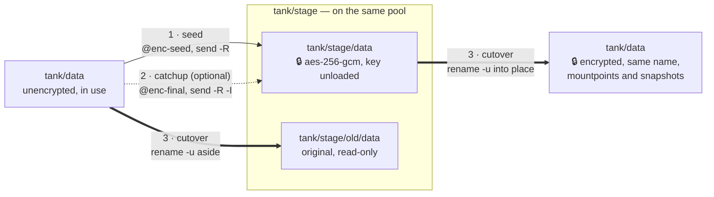

# zfs-encrypt-migrate

**Migrate existing unencrypted OpenZFS datasets to native encryption in place, one at a time.**

<div style="text-align: center; margin: 2rem 0;">
  
</div>

`zfs-encrypt-migrate` moves a dataset onto native encryption while keeping its name, its mountpoints and its snapshots, using free space on the same pool instead of spare disks.

There are two steps per dataset:

- **`seed`** copies the dataset into an encrypted staged copy while it stays in use
- **`cutover`**, during a short writer downtime, sends the last changes and swaps the encrypted copy into place

## Why zfs-encrypt-migrate?

OpenZFS can't switch on encryption for a dataset that already exists: `encryption` is fixed when the dataset is created.
The only way in is to send the data to a new encrypted dataset and put that one in the old one's place.
By hand, that means juggling free space, a final catch-up while writers are stopped, renames that must not mount anything on top of anything else, children with their own mountpoints, and receives that quietly create unencrypted children unless you pass the right flag.

`zfs-encrypt-migrate` makes that a safe, resumable, one-dataset-at-a-time procedure:

1. Pick a stage on the same pool, such as `tank/stage`.
2. `seed` each dataset into an encrypted copy under the stage, with its snapshots and properties.
3. Stop the writers and `cutover`: the encrypted copy takes the dataset's name, and the original waits read-only under `tank/stage/old` until you delete it.
4. For a dataset bigger than the free space, `file-move` moves its files in verified batches instead; see the [guide](guides.md#datasets-bigger-than-the-free-space).
5. Run `audit`, by hand or on a timer, to confirm nothing unencrypted is left.



It refuses rather than guesses:

- it never runs `zfs destroy`; it prints the command for you instead
- the staged copy's key stays unloaded whenever the tool isn't working on it, including after a failure or Ctrl-C
- only one migration is in flight under a stage at a time
- copies refuse to eat into a free-space floor (`--min-free`, default `1T`)
- the swap unmounts first, never forces, and refuses if anything was written after the final snapshot
- after each catch-up, every dataset in the staged tree is checked to be encrypted under the staged root
- a failed swap prints recovery commands for the exact step it reached

See the [safety model](usage.md#safety-model) for the full list and its limits.

<div style="text-align: center; margin: 2rem 0;">
  <a href="https://pypi.org/project/zfs-encrypt-migrate/" class="md-button md-button--primary">
    Install from PyPI
  </a>
  <a href="https://github.com/basnijholt/zfs-encrypt-migrate" class="md-button">
    View on GitHub
  </a>
</div>

## Quick Start

```bash
# Install on the ZFS host
uv tool install zfs-encrypt-migrate

# As root: the stage is required and never guessed
export ZFS_ENCRYPT_MIGRATE_STAGE=tank/stage

# Copy tank/data to an encrypted staged copy (needs the key file, see Getting Started)
zfs-encrypt-migrate seed tank/data

# Stop the writers, then swap the encrypted copy into place
zfs-encrypt-migrate cutover tank/data

# List what is still unencrypted
zfs-encrypt-migrate audit --exact tank --subtree tank/stage tank
```

[Get Started](getting-started.md){ .md-button .md-button--primary }
[View Usage](usage.md){ .md-button }
[Read the Guides](guides.md){ .md-button }

## NixOS Support

Nix is optional.
The Python CLI runs on any Linux host whose OpenZFS supports `zfs rename -u` (tested on OpenZFS 2.4), and the flake adds a NixOS module that installs it and runs the audit on a timer.

## Background

`zfs-encrypt-migrate` is the sibling of [`zfs-unlock`](https://zfs-unlock.nijho.lt): this tool encrypts your datasets once, and `zfs-unlock` unlocks them after every reboot without keeping the keys on the storage host.
